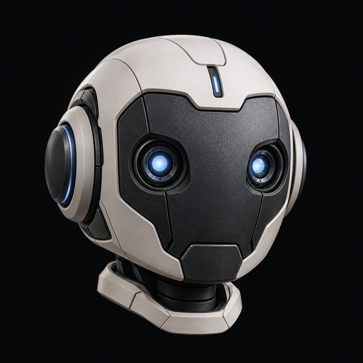

# 机器人头像

生成模式：内置 `image_gen.imagegen`，未使用 API/CLI，未读取账户凭据。

- 网站资产：`public/avatar.png`
- 个人主页素材包：`github-profile/assets/avatar.png`
- 原始高分辨率生成图保存在本地工作区，不随本仓库分发。
- 尺寸：1254 × 1254 px；RGB PNG；非透明近黑背景。
- 使用：网站头像与 GitHub 头像，可直接圆形裁剪。

## 质量检查

已检查主体与背景：浅灰陶瓷外壳、石墨面板、冰蓝双目；近黑背景，轮廓清晰。没有文字、商标、水印或额外物体。主体居中，圆形裁剪不切到头部。双目与外轮廓在小尺寸下仍是主要辨识特征。

原图生成后按字节复制到交付路径，未做图像编辑或覆盖生成原图。GitHub / Gitee 账号头像设置尚未更改。

## 小尺寸预览

下列预览引用同一张原图，以 CSS 呈现圆形裁剪，不改动 PNG：




## 最终 prompt

```text
Use case: stylized-concept
Asset type: square professional avatar for a GitHub profile and an embedded systems / robotics internship portfolio.
Primary request: create an original, refined robot head avatar that communicates hands-on engineering, precise motion control, and curiosity. This is a fictional robot, not a portrait of a person.
Scene/backdrop: a clean uniform near-black graphite background, no environment or extra objects.
Subject: one compact robotic head, front-facing with a very subtle three-quarter perspective, a strong recognizable silhouette, a precision-machined graphite face panel surrounded by a warm light-gray ceramic shell. Two small restrained ice-blue optical eyes and one fine blue indicator detail. A few functional panel seams only. No mouth expression, no smile, no aggressive appearance.
Style/medium: exceptionally polished minimal 3D industrial design product render, tactile matte materials, elegant mature editorial visual identity.
Composition/framing: square image; the whole head centered and entirely inside the central 70 percent of the canvas so it survives circular cropping; generous clear dark margin on all sides; head fills enough space to remain readable at 48 pixels.
Lighting/mood: soft controlled studio light, crisp silhouette separation, subtle ceramic highlights and graphite texture, calm and confident.
Color palette: almost-black #090a0d, warm off-white #f0f2f5, graphite gray, a single restrained ice-blue #91b5ff accent.
Constraints: no text, no lettering, no logo, no watermark, no circle or border around the subject.
Avoid: busy machinery, wires, background particles, grids, holograms, rainbow colors, excessive neon, cyberpunk decoration, cartoon baby proportions, humanoid skin, intricate tiny parts, weapons.
```
